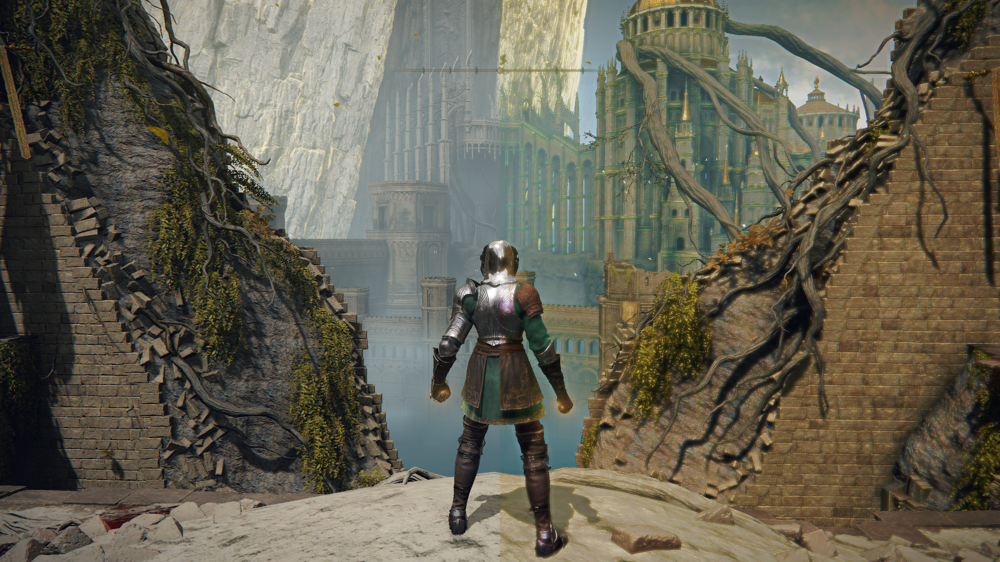
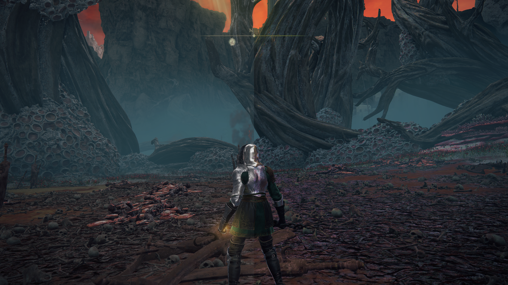
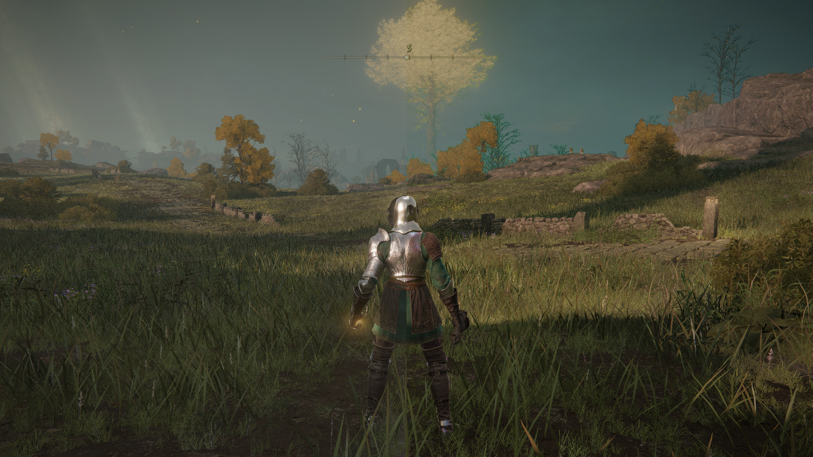

# Lazara

Lazara is a ReShade color effect for recovering muted scene color from evidence
already present in the image. It can also reverse direction and deliberately
degrade color without discarding the source brightness structure.

The effect does not assign a preferred hue. Red, green, blue, amber, cyan,
violet, skin and earth tones are treated from the same source-derived evidence
model.

**Status:** source and recorded static/model checks are available. Live ReShade
compilation and visual acceptance remain pending; the gallery is a supplied
comparison set, not a complete validation record.

**Explore:** [Gallery](#gallery) · [Method](#what-it-does) ·
[Recovery and degradation](#recovery-and-degradation) ·
[Installation](#installation) · [Controls](#main-controls) ·
[Development](#work-on-lazara) · [Validation](#validation-status).

## Gallery

### Lead comparison

User-supplied scene with a hard 50/50 center split.



**Left:** Unenhanced. **Right:** Enhanced.

### Effects comparison

User-supplied comparison of the same scene with a hard 50/50 center split.



**Left:** No effect. **Right:** Effects enabled.

### Enhancement comparison

Second user-supplied scene with a hard 50/50 center split.



**Left:** Original. **Right:** Enhanced.

## What it does

- identifies muted, locally flat regions without relying on a fixed color;
- selects the strongest nearby chromatic sample that remains compatible in
  brightness;
- recognizes analogous, complementary, triadic and split-complement color
  relationships;
- strengthens an observed hue or gently migrates a weak non-neutral hue toward
  accepted local evidence;
- protects neutral surfaces and bright highlights;
- preserves luma while rebuilding saturation;
- limits chromatic separation to admitted muddy regions;
- exposes the masks and evidence used by the decision.

## Recovery and degradation

`Invert Color Recovery` is a production control, not a debug display filter.

| Mode | Behavior |
|---|---|
| `Recover Color` | Runs Lazara's source-derived tone, saturation, harmony and optional chromatic-split reconstruction. This is the default. |
| `Degrade Color` | Bypasses color revival and chromatic-split sampling, then moves RGB toward source luma to remove chroma while preserving brightness structure. |

The separate `Debug Visibility Mode > Invert` option only changes how
non-final diagnostic views are displayed.

## Installation

1. Download or clone this repository.
2. Merge its `reshade-shaders` directory into the ReShade installation beside
   the existing `reshade-shaders` directory.
3. Keep `Shaders/rm/effects` and `Shaders/rm/header` in their current relative
   positions.
4. Ensure ReShade's effect search path includes
   `.\reshade-shaders\Shaders\**`.
5. Reload ReShade and enable `OCCULT lazara`.

The repository includes the `ReShade.fxh` used by the local preprocessing
check. Back up an existing copy before replacing it, and keep a newer
installation-provided copy when required by the installed ReShade version.

## Main controls

| Control | Default | Purpose |
|---|---:|---|
| Enable lazara | On | Master effect switch. |
| Invert Color Recovery | Recover Color | Selects reconstruction or intentional degradation. |
| Color Strength | 1.45 | Overall source-derived color invigoration. |
| Muted Color Lift | 1.75 | Additional recovery for present but washed-out color. |
| Dominant Hue Vibrancy | 1.65 | Moves the observed winning hue toward a stronger luma-preserving result. |
| Muted Hue Migration | 0.20 | Allows bounded movement of weak non-neutral color toward accepted local evidence. |
| Tone Contrast | 1.14 | Shapes flat tone before color reconstruction. |
| Manual Temperature Bias | 0.00 | Optional artistic warm or cool override; zero is evidence-only. |
| Harmony Boost | 1.55 | Strengthens supported local color relationships. |
| Harmony Guidance | 0.24 | Controls how strongly harmony guides recovery strength. |
| Harmony Tolerance | 0.09 | Width of the accepted color-relationship bands. |
| Highlight Protect | 0.60 | Reduces reconstruction in bright highlights. |

Mud targeting and chromatic-split controls are available for narrower tuning.
`View` exposes the selected color result, masks, local palette, harmony support,
vibrancy drive and hue migration. The debug visibility controls affect those
diagnostic views only.

## Repository layout

```text
reshade-shaders/
  Shaders/
    ReShade.fxh
    rm/
      effects/OCCULT_lazara.fx
      header/*.fxh
docs/
  images/
  VALIDATION.md
MANIFEST.sha256
```

[`OCCULT_lazara.fx`](reshade-shaders/Shaders/rm/effects/OCCULT_lazara.fx) is
the effect entry point. The header directory is the complete transitive include
closure required by that source.

## Validation status

Passed locally:

- complete include-graph resolution;
- package path and duplicate-entry checks;
- SHA-256 verification;
- balanced source delimiters and control wiring checks;
- 24 representative color-model cases with non-increasing chroma and preserved
  weighted luma;
- package-only preprocessing against the bundled header tree.

Still required for promotion:

- live ReShade compilation with warning review;
- visual comparison across saturated, muted, neutral, highlight and skin/earth
  scenes;
- confirmation that switching back to recovery restores the prior result.

The detailed evidence and stop conditions are recorded in
[`docs/VALIDATION.md`](docs/VALIDATION.md).

## Work on Lazara

Start in [OCCULT_lazara.fx](reshade-shaders/Shaders/rm/effects/OCCULT_lazara.fx):
the controls and effect implementation live together. Trace a proposed change
through the recovery/degradation decision, local color evidence, neutral and
highlight protection, diagnostic view, and final composite.

| Area | Starting point |
|---|---|
| Effect controls and processing | [OCCULT_lazara.fx](reshade-shaders/Shaders/rm/effects/OCCULT_lazara.fx) |
| Shared effect dependencies | [Header directory](reshade-shaders/Shaders/rm/header/) |
| Diagnostic visibility | [MIXSR_API_DebugVisibility.fxh](reshade-shaders/Shaders/rm/header/MIXSR_API_DebugVisibility.fxh) |
| Recorded checks and live stop conditions | [docs/VALIDATION.md](docs/VALIDATION.md) |
| Supplied comparison provenance | [Image notes](docs/images/README.md) |
| File identity | [MANIFEST.sha256](MANIFEST.sha256) |

Keep recovery and deliberate degradation independently inspectable. When
reporting a change, state the mode and diagnostic view, the expected result,
and the observed result. Preserve the existing validation boundary until the
effect has compiled and been compared in an actual ReShade session.

## License status

No project-wide license has been assigned yet. The bundled `ReShade.fxh`
retains its own `SPDX-License-Identifier: CC0-1.0` declaration.
